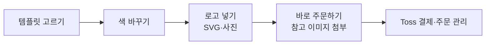
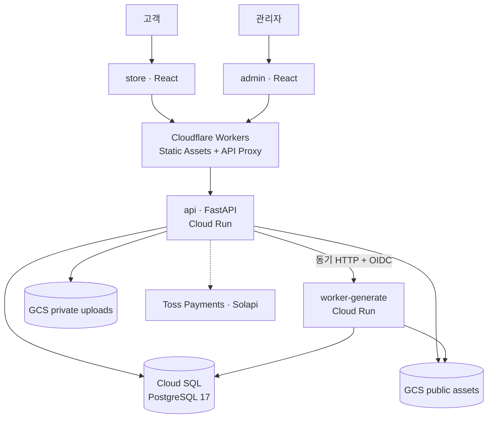

# ESSE SION

> 넥타이 커머스와 결정론적 seamless textile 엔진을 하나의 계약 중심 모노레포로 재설계한 프로젝트

**현재 상태:** 애플리케이션 구현·로컬 검증 완료 · **production 미개통**


<p align="center"><sub>GPT Image로 제작한 포트폴리오 콘셉트 비주얼입니다. 실제 런타임 결과 화면은 아니며, 사용한 프롬프트는 <a href="./docs/assets/portfolio-hero.prompt.md">여기</a>에서 확인할 수 있습니다.</sub></p>

## 프로젝트 소개

ESSE SION은 기존 커머스 프론트엔드 **YeongSeon**과 독립 이미지 생성 서비스 **seamless-tile**을 통합해 처음부터 다시 구현한 cloud-native 커머스 플랫폼입니다.

기존 구조에서는 프론트엔드가 Supabase Auth·DB·Storage·Edge Functions에 직접 결합되어 있었고, 이미지 서비스의 장시간 생성 작업과 세션 상태는 단일 프로세스에 묶여 있었습니다. 새 구조는 다음 경계를 명확히 했습니다.

- 프론트엔드는 DB를 알지 못하며 OpenAPI에서 생성한 `packages/api-client`로만 통신합니다.
- 인증·인가·주문·결제는 FastAPI `api`가 단일 소유합니다.
- 넥타이 디자인은 시드 코드로 관리하는 템플릿(typed design plan)에서 시작하고, 배치·합성·seam은 결정론적 Python 엔진이 담당합니다. 고객 로고는 SVG 업로드 또는 사진→SVG(로컬 VTracer) 변환으로 넣으며, 외부 AI provider를 호출하지 않습니다.
- 꾸민 디자인은 맞춤 주문의 참고 이미지로 넘어가 사람이 생산 사양을 확정합니다.
- Supabase 런타임 의존성을 제거하고 PostgreSQL·GCS·GCP IAM 경계로 재설계했습니다.

코드는 기존 저장소에서 이식하지 않고 새로 작성했으며, 도메인 의미와 핵심 동작 계약은 테스트와 매핑 문서로 보존했습니다.

## 결과 요약

| 영역 | 구현 결과 |
|---|---|
| 계약 | OpenAPI **130 paths / 156 operations**(2026-10-19 기준), TypeScript SDK·TanStack Query 옵션·Zod 스키마 자동 생성, CI drift 차단 |
| 품질 | Python **1,238** + Vitest **518** 테스트, Ruff·Pyright·Biome·빌드·타입 검사·모듈 경계 gate (전체 실행은 CI가 정본, 2026-08-14 기준) |
| 이미지 엔진 | 25개 intent 골든과 25개 템플릿 플랜 컴파일러 골든, 대표 seed 변형, 대표 compose의 `PYTHONHASHSEED=0/1/12345` 교차 검증으로 byte-identical SVG 계약 보호 |
| 데이터 | SQLAlchemy 모델을 정본으로 두고 모든 스키마 변경을 Alembic으로 관리, 실제 PostgreSQL 기반 인가·동시성 테스트 |
| 운영 경계 | Cloudflare exact-secret, Cloud Run OIDC, 공개/비공개 GCS 버킷 분리, WIF 배포 파이프라인 구현 |

보안·동시성·공급망 감사 기록은 [2026-07 리팩터링 감사](./docs/reviews/repo-refactor-2026-07.md)에 있습니다.

## 사용자 경험



### 왜 템플릿에서 시작하고, 마무리는 사람이 하는가 (고객 관점의 핵심)

넥타이 디자인을 처음부터 그리게 하면 고객은 무엇을 원하는지 말로 풀어야 하고, 결과는 생산에 그대로 쓸 수 없다. 2026-10-19까지 운영한 AI 디자인 생성(문장 → 디자인, 원단 실사화)을 걷어내고 흐름을 줄인 이유다.

- **고르기가 말하기보다 쉽다** — 검수된 템플릿 중 하나를 고르고 색과 로고만 바꾸면 된다. 줄무늬 폭·간격·로고 자리 같은 값은 템플릿이 이미 넥타이 비율에 맞춰 정해 둔다.
- **화질과 재현성** — 결정론 SVG 엔진은 몇 번을 바꿔도 벡터 그대로라 화질이 변하지 않고, 같은 입력이면 같은 결과가 나온다.
- **생산은 사람이 확정한다** — 꾸민 디자인은 맞춤 주문의 참고 이미지로 넘어가고, 원단·직조 사양은 디자이너가 주문을 보고 정한다. 외부 생성 비용도 사라진다.

### Store

- 상품 탐색·상세, 게스트/회원 장바구니, 쿠폰, 배송지
- 일반·수선·맞춤·샘플 주문과 Toss 결제
- 주문·클레임·문의·견적·마이페이지
- 디자인 템플릿 목록, 색·로고 편집(SVG 업로드·사진→SVG), 꾸민 디자인으로 바로 맞춤 주문
- 반응형 UI, 접근성·200% zoom·reduced motion 검증

### Admin

- 대시보드, 주문·상품·쿠폰·견적·클레임·고객·문의 관리
- 맞춤 단가·설정 관리, 디자인 렌더 로그·무늬·로고·템플릿 운영
- 결제 인시던트 대사와 관리자 복구 흐름
- 관리자/매니저 역할 게이트와 감사 가능한 mutation 경계

### Design engine

- `템플릿 플랜(DesignPlan v3) → compiler → intent → deterministic SVG` 파이프라인
- lattice·path-following·scatter·point-set 배치와 torus 좌표계
- 로고 교체는 intent의 로고 자리 모티프만 바꾼 결정론 재렌더, 사진 로고는 로컬 VTracer로 SVG 변환
- Pillow + librsvg 기반 preview
- content hash와 create-only 업로드를 통한 재시도 안전성

## 아키텍처



프론트는 Vite로 빌드한 정적 자산을 Wrangler로 Cloudflare Workers에 배포합니다. API와 worker는 Cloud Run, DB는 Cloud SQL PostgreSQL이 담당합니다. 별도 staging 프로젝트 없이 단일 production GCP 프로젝트만 운영합니다.

핵심 설계 결정 다섯 가지입니다.

- **API 계약이 단일 정본** — FastAPI OpenAPI에서 프론트 SDK·쿼리 옵션·런타임 스키마를 생성하고, CI가 drift를 차단합니다.
- **출력 보장은 엔진이 진다** — 템플릿 플랜을 compiler가 intent로 확정한 뒤에는 seeded RNG·정렬·canonical hash만 사용해 byte-identical SVG를 냅니다.
- **돈 경로는 API가 단독 소유** — 주문·쿠폰·Toss 대사를 DB 트랜잭션과 advisory lock 아래 처리하고 provider key·금액·상태를 재검증합니다.
- **재시도를 정상 흐름으로 설계** — 렌더 결과는 content hash 키에 `if_generation_match=0`으로 생성하고, 로고 교체는 세션당 lease로 하나만 진행합니다.
- **공개 결과와 고객 첨부를 물리적으로 분리** — public assets / private uploads 두 버킷을 두고, 고객이 올린 사진·주문 참고 이미지는 private에만 둡니다.

각 결정의 근거와 기각한 대안, 신뢰 경계와 장애 복구 방식은 [ARCHITECTURE.md](./ARCHITECTURE.md)에 있습니다.

## 기술 스택

| 영역 | 기술 |
|---|---|
| Frontend | React 19, TypeScript 6, Vite 8, React Router 8, TanStack Query 5, Zod, Tailwind CSS 4 |
| Design system | `packages/shared`, semantic tokens, dependency-free primitives/components, Vitest drift guards |
| API | Python 3.13, FastAPI, Pydantic, SQLAlchemy 2 async, asyncpg, Authlib, JWT/Argon2 |
| Image pipeline | Deterministic Python engine, Pillow, librsvg, VTracer |
| Data | PostgreSQL 17, Alembic, testcontainers |
| Cloud | Cloudflare Workers, Cloud Run, Cloud Scheduler, Cloud SQL, GCS, Secret Manager |
| Tooling | pnpm 10 workspaces, uv, mise, Biome, Ruff, Pyright, Playwright, Schemathesis |
| Delivery | GitHub Actions, OpenTofu, Workload Identity Federation, Artifact Registry |

## 모노레포 구조

```text
essesion/
├── apps/
│   ├── store/          # 고객용 커머스·디자인 React 앱
│   ├── admin/          # 운영자 React 앱
│   ├── api/            # 인증·도메인·결제 FastAPI
│   └── worker/         # 결정론 이미지 엔진·사진→SVG
├── packages/
│   ├── api-client/     # OpenAPI 생성 SDK·Query·Zod
│   ├── shared/         # 디자인 토큰·공용 UI
│   └── tsconfig/
├── libs/               # Python 공용 observability·SVG safety
├── db/                 # SQLAlchemy 모델·Alembic
├── infra/              # OpenTofu·Cloudflare 설정
├── scripts/            # 아키텍처·문서 gate 하네스
├── e2e/                # Store 돈 경로·Admin smoke
└── docs/               # 명세·감사·운영 문서
```

## 로컬 실행

### 준비물

- Node.js 22, pnpm 10
- Python 3.13, uv
- Docker
- worker 렌더링용 `rsvg-convert`(librsvg)
- 선택: `mise install`로 저장소의 툴체인 버전 설치

### 1. 의존성과 환경 변수

```bash
pnpm install --frozen-lockfile
uv sync --all-packages
cp .env.example .env
cp apps/store/.env.example apps/store/.env
cp apps/admin/.env.example apps/admin/.env
```

`apps/store/.env`의 `VITE_TOSS_CLIENT_KEY`에는 Toss 공개 테스트 client key를 입력합니다. 시크릿은 커밋하지 않습니다.

### 2. PostgreSQL과 스키마

```bash
docker compose up -d --wait
uv run alembic -c db/alembic.ini upgrade head
uv run python apps/api/scripts/seed.py                      # 계정·가격·설정
uv run python apps/worker/scripts/seed_motifs.py            # 모티프 카탈로그
uv run python apps/worker/scripts/seed_design_examples.py   # 디자인 템플릿
```

시드는 전부 멱등이며 순서대로 실행해야 합니다. 뒤 두 개를 건너뛰면 `/design` 템플릿 목록이 비어 있습니다.

### 3. 개발 서버

각 명령은 별도 터미널에서 실행합니다.

```bash
uv run uvicorn api.main:app --reload
uv run uvicorn worker.main:app --reload --port 8001
pnpm --filter store dev
pnpm --filter admin dev
```

로컬에서 Toss·Solapi 자격증명이 없으면 API는 해당 연동을 DryRun으로 실행합니다. 파일 스토리지는 별도 설정 없이 `docker compose up -d`의 fake-gcs-server(`localhost:4443`, `dev-uploads`/`dev-assets`)를 사용합니다. 디자인 경로는 외부 provider를 호출하지 않으므로 결정론 엔진과 골든 테스트를 그대로 검증할 수 있습니다. 배포 환경은 GCS 버킷 설정이 빠지면 기동하지 않습니다.

## 검증

환경 파일을 채운 뒤 저장소 루트에서 실행합니다.

```bash
pnpm codegen                                    # 스펙 변경 시 생성물 drift 확인
pnpm lint
pnpm architecture:check                         # 모듈 경계·문서 링크
pnpm build && pnpm typecheck && pnpm test

uv run pytest
uv run ruff check .
uv run ruff format --check .
uv run pyright
```

돈 경로와 관리자 흐름의 브라우저 smoke는 실제 로컬 PostgreSQL을 사용합니다.

```bash
pnpm test:e2e
```

## 현재 상태와 다음 단계

완료된 범위:

- Store·Admin·API·worker·DB 마이그레이션 구현
- Supabase 신규 런타임 의존 제거와 OpenAPI client 전환
- 소셜 로그인 4종(Google·Kakao·Naver·Apple) 코드 경로
- 로컬 통합 테스트·브라우저 smoke·CI/CD·OpenTofu 구성
- 결제·문자 local DryRun과 GCS 로컬 에뮬레이터 경계
- GCP/OpenTofu, Cloudflare custom domain, Secret Manager와 worker·batch OIDC 개통

## 문서

| 문서 | 역할 |
|---|---|
| [ARCHITECTURE.md](./ARCHITECTURE.md) | 시스템 경계, 요청 흐름, 신뢰 경계, ADR |
| [infra/README.md](./infra/README.md) | 개통 명령 정본 (gcloud·tofu·wrangler·시드) |
| [db/README.md](./db/README.md) | 스키마 규칙·마이그레이션·설계 의도 |
| [docs/api-spec/](./docs/api-spec/domains.md) | 도메인·돈 경로·worker 엔진/파이프라인/모티프 계약 |
| [apps/admin/AGENTS.md](./apps/admin/AGENTS.md) | admin 접근성·상태 변경 계약 |
| [packages/shared/AGENTS.md](./packages/shared/AGENTS.md) | 디자인 시스템 사용 규칙 |
| [AGENTS.md](./AGENTS.md) | 에이전트·기여자용 개발 하네스 |
